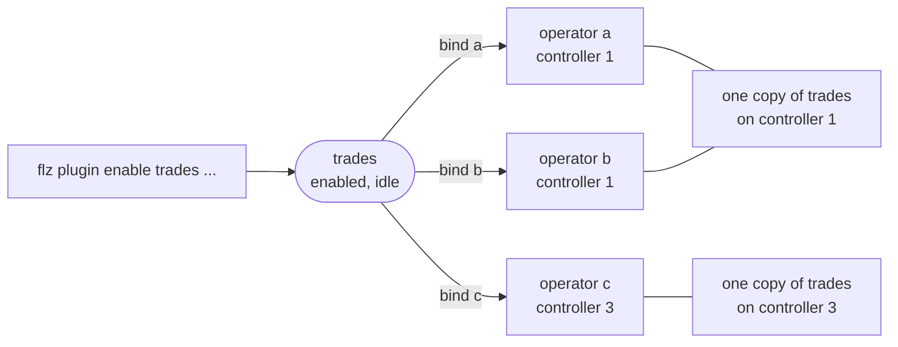

# Plugins

A plugin connects an operator to something outside Flezha: a file, a websocket, an HTTP
endpoint, Kafka, a database. It runs in the controller, at the edge of the operator. A
**source** plugin feeds one of the operator's entry channels, and a **sink** plugin takes
what the operator sends out on one of its sinks. A third sort, the controller plugin, is
bound to no operator at all: it is told what happens in a namespace.

Plugins exist so that an operator's code never names where its data comes from or goes.
An operator declares where data comes in and goes out, and a user decides what is on the
other side. The same operator reads from a file today and from Kafka tomorrow with no
rebuild, and a plugin can be added, changed or removed while the operator runs.

## How it works

A plugin goes through three steps, each its own act:

1. **Installed.** A controller has a provider when its release ships it (the built-in
   plugins) or when a plugin package that provides it is installed on that controller. A
   package is installed per controller, through `FLEZHA_PLUGINS` or `flz plugin install`,
   and loaded when the controller starts; [`installing_plugins.md`](../advanced/installing_plugins.md)
   covers it.
2. **Enabled.** `flz plugin enable <name> <provider>` records a plugin under a name of its
   own in a namespace, with its options, for the whole cluster. No operator is named and
   nothing starts: the plugin is listed `idle`. It survives a controller restart and a
   whole-cluster cold start.
3. **Bound.** `flz plugin bind <name> --operator_id <op>` connects an operator to the
   plugin. The plugin starts where that operator runs. A binding travels with its
   operator through a move, a restart and a cold start.



### Two types

| Type | Bound to | Runs |
| --- | --- | --- |
| operator plugin | one or more operators | on each controller where an operator bound to it runs, and nowhere else; stops when no bound operator runs there, and stays enabled |
| controller plugin | no operator | on every controller that holds its namespace, from its enable until it is disabled; it never stops for want of operators |

Every catalogue page in [`docs/plugins/`](https://github.com/flezha/flezha/tree/main/docs/plugins) says which type a plugin is. A
controller plugin is enabled with its hooks and is told what happened through them;
[`hooks.md`](../advanced/hooks.md) covers it. The rest of this page is about operator
plugins.

### Shared or one per operator

A plugin's provider declares whether one running copy can serve several operators:

- **Shareable** (a websocket, an HTTP poll, an HTTP push, the Kafka and RabbitMQ
  producers): each controller runs one copy for every unpartitioned operator bound to the
  plugin there, so a source opens one upstream connection and a sink runs one worker,
  however many operators share it.
- **Not shareable** (a file reader with one offset, a server on one port, a consumer
  holding one group member): the plugin serves one operator. Binding a second operator is
  refused with `plugin.not_shareable`, naming the operator that holds it. Enable another
  plugin of the same provider for the second operator.

`--single` at enable runs one copy in the whole cluster instead, on a controller the
cluster chooses, delivering to every bound operator on any controller. It applies to both
types. A `single` plugin takes no `on_output` hook (`plugin.single_sink`): one copy cannot
be every operator's sink. When its controller leaves gracefully, the copy moves with a
hand-over that opens the new connection before the old one closes; when its controller
fails, it starts on another and its operators are served again without being bound again.

### A shared feed

A shared source hands every record to every operator bound to it, straight from the
worker that reads it, without waiting on any operator. A slow operator falls behind in
its own input queue and loses nothing, and the others are not slowed. A newly bound
operator is told to the worker when it binds, so it gets what arrives from then on (a
shared HTTP poll offers it the current content at the next poll).

### Partitioned operators

A plugin bound to a partitioned operator runs one copy on every member of the group,
shareable or not and `single` or not, and a member's copy is never shared with another
operator. Unbinding the group stops the members' copies and leaves any shared copy
running for its other operators. A websocket source on a group subscribes each member to
its own share of the items, and an HTTP poll can name the member's partition in its URL.

A source that cannot tell which member a record's key belongs to refuses a group member
with `plugin.partitioned_host`: the Kafka consumer, the RabbitMQ consumer, Postgres change
capture, the Postgres poll source and the HTTP server. Bind it to an operator that is not
partitioned and route from there. [`partitioning.md`](../advanced/partitioning.md) covers
groups.

### When a copy stops

A running copy whose last bound operator on that controller leaves stops:

- at once when the leave was deliberate: an unbind, an operator stop, an operator that
  ended;
- after `FLEZHA_PLUGIN_IDLE_STOP_MS` (default `60000`) when the operator went down or
  moved, unless a bound operator arrives first. A crash followed by a restart within that
  time keeps the connection open throughout.

A stopped plugin stays enabled and starts again when a bound operator runs. On an
operator's move the plugin starts on the new controller when the operator brings its
plugins up there, and the copy on the old controller stops only once the operator has
left it and the idle stop has passed, so the new connection opens before the old one
closes.

Only `flz plugin disable <name>` turns a plugin off. It stops every running copy on every
controller and leaves every binding on its operator. Each bound operator keeps running and
reports `plugin_unhealthy` with `plugin.not_found` for that binding, and enabling a plugin
of that name again brings the bindings up.

### A controller without the provider

Each controller has its own installed packages. When another controller that holds the
namespace lacks the provider, `flz plugin enable` warns, naming it: the plugin will not run
there. An operator bound to the plugin and placed on such a controller still runs and
processes its inputs, without the plugin:

- its health reports `plugin_unhealthy` with `plugin.provider_not_loaded`, naming the
  controller, and one warning is logged naming the plugin and why;
- a delivery-guaranteed output to that sink waits in the outbox and is delivered once the
  binding starts; a plain output is dropped and counted;
- the binding is tried again at the operator's next bring-up, so it comes up on a
  controller that has the package.

A controller plugin runs no copy on a controller that lacks its provider.

### Plugins follow the operator's durability

The controller tells each plugin how the operator it serves keeps its input, over anything
the plugin's stored options say. A source moves its upstream position (an offset, a
cursor, an acknowledgement) only past records the operator took, and how often follows
the operator:

| The operator | A verdict `ok` means | The source moves its position |
| --- | --- | --- |
| a flow operator without `effectively_once` that does not sleep | the operator took the record | every few seconds |
| a durable steps operator, or a flow operator that sleeps | the record is in the operator's input log | after every confirmed batch |
| a flow operator with `effectively_once` | the record is in the operator's input log | after every confirmed batch; a sink that honours `effectively_once` writes each output once |

An operator whose input is durable (effectively-once, sleeping or durable steps) does not
share a shareable source: it runs the source on its own, so every record is confirmed to
it, and a slow one holds back only its own upstream connection.

On the sink side, a delivery-guaranteed output is held in the operator's outbox until the
sink confirms it. What each sink honours (written once, at least once, or best effort) is
the Durability row of its catalogue page. [`durability.md`](durability.md) has the levels,
and [`effectively_once.md`](../advanced/effectively_once.md) the tier.

## How to use it

### The commands

| Command | What it does |
| --- | --- |
| `flz plugin enable <name> <provider> [--single] [--X<option>=<value>]...` | enable a plugin by name; with `--operator_id` it also binds that operator |
| `flz plugin bind <name> --operator_id <op> [--hook=<hook>]... [--channel <c>]` | bind an operator to an enabled plugin |
| `flz plugin unbind <name> --operator_id <op>` | take the binding away; the plugin stays enabled |
| `flz plugin update <name> [--X<option>=<value>]...` | change an enabled plugin's options |
| `flz plugin disable <name>` | turn the plugin off |
| `flz plugin list` | the plugins enabled in the namespace |
| `flz plugin list --providers` | the providers this controller can enable (text only) |
| `flz plugin list --installed` | the installed packages |
| `flz plugin help <provider>` | a provider's options and hooks |

Every verb takes `--namespace` (default `default`). `enable` reads `--namespace`,
`--single`, `--operator_id`, `--hook`, `--channel` and the X-prefixed settings; `bind`
reads `--namespace`, `--operator_id`, `--hook` and `--channel`; `unbind` reads
`--namespace` and `--operator_id`; `update` reads `--namespace` and the X-prefixed
settings; `disable` reads `--namespace`. Each refuses any other option rather than
dropping it.

### Three kinds of flags

`flz plugin enable` takes three kinds of flags:

| Flag | Belongs to | For example |
|---|---|---|
| `--operator_id`, `--namespace`, `--single`, `--channel` | the command: which operator the plugin is bound to, and how | `--operator_id=trade_watcher` |
| `--hook` | the binding: when the controller calls the plugin | `--hook=on_output` |
| `--X<option>` | the plugin: its own settings, one flag each | `--Xuri=ws://localhost:4500/` |

The `X` keeps a plugin's settings apart from the command's own flags: `--Xchannel` is the
plugin's `channel` setting, not an option of `flz`. A setting is written
`--X<option>=<value>`, `--X<option> <value>`, or without its dashes as
`X<option>=<value>`. A value is plain text, unless it is written as JSON, a list in
`[...]` or an object in `{...}`, in which case the plugin gets it as JSON. Quote such a
value, so the shell passes it as one word.

Every provider lists its settings, required ones first, then its type and the hooks it
supports:

```sh
$ flz plugin help operator_websocket
```

```output
Websocket Plugin Help

USAGE:
    flz plugin enable <name> operator_websocket [OPTIONS]

REQUIRED PARAMETERS (X-prefixed):
    --Xuri <value>    The websocket endpoint to connect to

OPTIONAL PARAMETERS (X-prefixed):
    --Xplugin_id <value>    Plugin id; defaults to the id it was enabled under
    --Xignore_pattern <value>    Substring marking a frame as a heartbeat rather than data
...
```

### Names, enables and binds

- A name is unique in its namespace. Enabling a name that is enabled with the same
  provider leaves the existing plugin untouched and says so (its options are not
  compared); with another provider it is refused with `plugin.id_taken`.
- `enable ... --operator_id <op>` enables and binds in one command. A bind that fails there
  leaves the plugin enabled, and the output says so before the refusal.
- A bind to a name that is not enabled is refused with `plugin.not_found`; an unbind of a
  binding the operator does not have, with `plugin.not_bound`. Binding a controller plugin
  is refused with `plugin.not_bindable`.
- `--channel` on a bind names the entry channel that operator's records arrive on, when it
  is not the one the plugin was enabled with: one plugin can feed `trades` on one operator
  and `ticks` on another.
- Options belong to the enable and the update; a bind that carries `--X` settings is
  refused.

### Hooks

A hook is the moment the controller calls a plugin, and it belongs to a binding. A source
needs none: its connection is held by the provider's own worker, which starts whether or
not the binding names a hook.

| Hook | The plugin is called |
|---|---|
| none | never; a source pushes its input in by itself |
| `on_output` | with everything the operator sends out |
| `on_input` | with everything the operator takes in |
| `on_interval` | on a timer, every `interval_ms`, which it requires |

`--hook=<name>` names one and may be repeated. A hook takes settings of its own, written
after it with the hook's name and a dot: `--hook=on_interval --on_interval.interval_ms=5000`.
`flz plugin help <provider>` lists the hooks a provider supports, and
[`hooks.md`](../advanced/hooks.md) has every hook.

### Change a running plugin

```sh
$ flz plugin update trades --Xsubscription_items='["EUR/USD","GBP/USD"]'
```

```output
Plugin trades updated in place.
```

`flz plugin update` validates the new options against the provider's declaration and
records them. When every changed option is one the provider declares live, every running
copy applies it in place, with no restart and no reconnect. Otherwise every running copy
restarts with the new options, and the command prints a warning naming the bound operators:

```output
Plugin trades updated; its running copies restarted.
warning: restarted under a, b
```

An update that changes nothing prints `Plugin trades is unchanged.`

### See what runs

`flz plugin list` shows each plugin in the namespace: its name, its provider's name,
whether it is `single`, the operators bound to it, and the controllers it runs on, or
`idle`. A controller plugin's row also names its hooks and the controllers its copy lags
on. `--json` prints the same rows as JSON.

```sh
$ flz plugin list --namespace trading
```

```output
exchange  websocket  bound: trade_watcher  runs on: flezha@127.0.0.1
```

`flz operator info` lists every operator in the namespace and, under each one, the plugins
bound to it: the plugin's name, its provider module, the hook it is on, what the provider
reports about itself (a file plugin's full path, a websocket's subscriptions), and whether
it is healthy. When an operator shows `degraded`, this is where to look for the plugin
that is not healthy.

```sh
$ flz operator info
```

```output
Fetching operator information for namespace 'default'...
Operator information for namespace 'default':

Operator: my_echo
  Run: flow
  Durable: local (sleep_after: false)
  Phase: running
  Health: healthy
  Runner ID: default_b2e389ab1c13
  Group ID: default
  Uptime (ms): 7249
  Default Input Type: 2
  Waiting callers: 0
  Plugins:
    - reader: Flezha.Plugin.Provider.File.Source
        path: /opt/flezha/app_data/files/echo-in.txt
        health: :healthy
    - writer: Flezha.Plugin.Provider.File.Sink
        hook: on_output []
        path: /opt/flezha/app_data/files/echo-out.txt
        health: :healthy
```

`reader` has no hook line, because a source is not sent anything.

### At an operator's start

`flz operator start` (and `flz schedule add`) take `--plugins`, a JSON array of plugin
specs to bind at start. Each spec names a plugin (`name`) and the hooks the operator is
bound with (`hooks`, which a source may leave out). A spec that also names a `provider`,
with its `opts` and `single`, enables the plugin when it is not enabled yet; a spec that
only binds may name the binding's `channel` in its `opts`. Any other key is refused.

```sh
$ flz operator start order_executor --id order_1 --namespace trading \
  --text '{"symbol": "EUR/USD", "quantity": 10}' --channel order \
  --plugins '[{"name": "order_1_file", "provider": "operator_file_sink", "opts": {"path": "order_1.txt"}, "hooks": [["on_output", {}]]}]'
```

```output
Started order_1
```

An operator entry declared with plugin rows of the earlier form (plugins carried on the
operator rather than enabled by name) starts without them, and one warning names the
operator and the old plugin ids: enable and bind them again. Nothing converts them.

### From your own code

Enabling, binding, unbinding and disabling are on the SDK's admin handle, so an
application can attach the plugins its own namespace needs. The calls carry what the
command line carries: the plugin's name, its provider and the provider's own options under
`opts` at enable, then the operator and the hooks that `--hook=on_output` spells at bind.
Every echo example carries these lines commented out right after the operator's start,
ready to uncomment:

<!-- tabs-open -->

### Java

```java
// Main.java: the echo runner, with the admin calls commented out
// Admin admin = runner.admin();
// ObjectNode opts = JsonNodeFactory.instance.objectNode().put("path", "echo-out.txt");
// admin.enablePlugin("writer", PluginSpec.of("operator_file_sink").opts(opts));
// ArrayNode hooks = JsonNodeFactory.instance.arrayNode();
// hooks.addArray().add("on_output").addObject();
// admin.bindPlugin("writer", "my_echo", hooks, null);
```

[Full file](https://github.com/flezha/flezha_java_sdk/blob/main/examples/echo/src/main/java/com/flezha/examples/echo/Main.java)

### Rust

```rust
// main.rs: the echo runner, with the admin calls commented out
// let admin = runner.admin();
// admin.enable_plugin(
//     "writer",
//     &flezha_runner::PluginSpec::new("operator_file_sink")
//         .opts(serde_json::json!({ "path": "echo-out.txt" })),
// )?;
// admin.bind_plugin("writer", "my_echo", serde_json::json!([["on_output", {}]]), "")?;
```

[Full file](https://github.com/flezha/flezha_rust_sdk/blob/main/examples/echo/src/main.rs)

### Node

```javascript
// runner.mjs: the echo runner, with the admin calls commented out
// const admin = runner.admin();
// await admin.enablePlugin('writer', 'operator_file_sink', { opts: { path: 'echo-out.txt' } });
// await admin.bindPlugin('writer', 'my_echo', { hooks: [['on_output', {}]] });
```

[Full file](https://github.com/flezha/flezha_node_sdk/blob/main/examples/echo/runner.mjs)

### Python

```python
# runner.py: the echo runner, with the admin calls commented out
# admin = runner.admin()
# admin.enable_plugin("writer", "operator_file_sink", opts={"path": "echo-out.txt"})
# admin.bind_plugin("writer", "my_echo", hooks=[["on_output", {}]])
```

[Full file](https://github.com/flezha/flezha_python_sdk/blob/main/examples/echo/runner.py)

### Ruby

```ruby
# runner.rb: the echo runner, with the admin calls commented out
# admin = runner.admin
# admin.enable_plugin("writer", "operator_file_sink", opts: { "path" => "echo-out.txt" })
# admin.bind_plugin("writer", "my_echo", hooks: [["on_output", {}]])
```

[Full file](https://github.com/flezha/flezha_ruby_sdk/blob/main/examples/echo/runner.rb)

### PHP

```php
// runner.php: the echo runner, with the admin calls commented out
// $admin = $runner->admin();
// $admin->enablePlugin('writer', 'operator_file_sink', ['path' => 'echo-out.txt']);
// $admin->bindPlugin('writer', 'my_echo', hooks: [['on_output', new stdClass()]]);
```

[Full file](https://github.com/flezha/flezha_php_sdk/blob/main/examples/echo/runner.php)

### Elixir

```elixir
# application.ex: the echo application, with the admin calls commented out
# alias Flezha.SDK.Admin
# runner = Flezha.SDK.RunnerServer
# {:ok, _} =
#   Admin.enable_plugin(runner, "writer", "operator_file_sink",
#     opts: %{"path" => "echo-out.txt"}
#   )
#
# {:ok, _} = Admin.bind_plugin(runner, "writer", "my_echo", hooks: [["on_output", %{}]])
```

[Full file](https://github.com/flezha/flezha_elixir_sdk/blob/main/examples/echo/lib/echo/application.ex)

<!-- tabs-close -->

The admin handle also has `unbindPlugin("writer", "my_echo")` and
`disablePlugin("writer")` (`unbind_plugin` and `disable_plugin` in Rust, Python, Ruby and
Elixir). [`namespaces.md`](namespaces.md) covers the whole admin handle. What it cannot do
is install, upgrade or uninstall a plugin package: those are node-wide acts, so they stay
with the user. An application may attach and detach the plugins its own namespace already
has.

## Examples

### A file in, a file out

The echo example declares one entry channel and one sink, and both ends are open to
plugins:

<!-- tabs-open -->

### Java

```java
// EchoOperator.java: the echo operator's channels
c.input(String.class, "in").into(Echo.class).sink("out");
```

[Full file](https://github.com/flezha/flezha_java_sdk/blob/main/examples/echo/src/main/java/com/flezha/examples/echo/EchoOperator.java)

### Rust

```rust
// operator.rs: the echo operator's channels
c.input::<String>("in").into::<Echo>().sink_named("out");
```

[Full file](https://github.com/flezha/flezha_rust_sdk/blob/main/examples/echo/src/operator.rs)

### Node

```javascript
// echo_operator.mjs: the echo operator's channels
c.input('in', { codec: 'text' }).into(EchoTasklet).sink('out');
```

[Full file](https://github.com/flezha/flezha_node_sdk/blob/main/examples/echo/echo_operator.mjs)

### Python

```python
# echo_operator.py: the echo operator's channels
c.input("in", codec="text").into(Echo).sink("out")
```

[Full file](https://github.com/flezha/flezha_python_sdk/blob/main/examples/echo/echo_operator.py)

### Ruby

```ruby
# echo_operator.rb: the echo operator's channels
c.input("in", codec: :text)
 .into(EchoTasklet)
 .sink("out")
```

[Full file](https://github.com/flezha/flezha_ruby_sdk/blob/main/examples/echo/echo_operator.rb)

### PHP

```php
// EchoOperator.php: the echo operator's channels
$c->input('in', codec: ChannelCodec::Text)
    ->into(EchoTasklet::class)
    ->sink('out');
```

[Full file](https://github.com/flezha/flezha_php_sdk/blob/main/examples/echo/src/EchoOperator.php)

### Elixir

```elixir
# operator.ex: the echo operator's channels
c |> input("in") |> into(Echo.Tasklet) |> sink("out")
```

[Full file](https://github.com/flezha/flezha_elixir_sdk/blob/main/examples/echo/lib/echo/operator.ex)

<!-- tabs-close -->

`in` names the channel messages come in on, and `out` the channel they leave on. A file
sink named `writer` writes everything `my_echo` sends out to `echo-out.txt`:

```sh
$ flz plugin enable writer operator_file_sink \
  --operator_id=my_echo \
  --hook=on_output \
  --Xpath=echo-out.txt
```

Read that as four things: `writer` is the plugin's name in the namespace,
`operator_file_sink` is which plugin, `--operator_id` is the operator it is bound to, and
`--hook=on_output` means **send this plugin everything the operator emits**.
`flz plugin bind writer --operator_id=<op> --hook=on_output` binds another operator later.

File plugins may touch one folder and nothing outside it: `app_data/files` inside the
directory the controller was started from by default (`/flezha/app_data/files`, inside the
data volume, under Docker), created the first time a file plugin is enabled.
`flz controller status | grep file_plugin_root` prints it, the boot prints the same path,
and `flz operator info` shows each file plugin's full path. A relative `path` is taken
under that folder. [`file.md`](../../plugins/file.md#the-root-folder) has the rules and
`FLEZHA_FILE_PLUGIN_ROOT`, and the warning that on several controllers each has its own
folder unless they share one or use an S3 bucket.

The sink creates `echo-out.txt` when the plugin is enabled, readable only by the user the
controller runs as. Its folder has to exist: the default `app_data/files` is made for you,
a subfolder such as `out/` in `--Xpath=out/echo-out.txt` is not. The sink never looks at
the extension. It writes in small batches, so a line lands a moment after the send:

```sh
$ flz operator send my_echo --text hello
```

```output
Delivered to 'my_echo'.
```

```sh
$ cat app_data/files/echo-out.txt
```

```output
echo: hello
```

One record, one line: the message bytes and a newline. `--Xchannel_out=out` writes only
the records from one channel; without it the sink writes every record its hook hands it.

A file source named `reader` sends every line added to `echo-in.txt` in on the `in`
channel:

```sh
$ flz plugin enable reader operator_file_source \
  --operator_id=my_echo \
  --Xpath=echo-in.txt \
  --Xchannel_in=in
```

`--Xchannel_in=in` is the entry channel each line is injected on. There is no `--hook`: a
source drives itself, reading the file and pushing lines in. It looks for new lines once a
second, remembers the byte offset of the last line the operator took, and resumes there
after a plugin restart, a move to another runner, or a controller restart.

```sh
$ echo "from a file" >> app_data/files/echo-in.txt
```

```sh
$ cat app_data/files/echo-out.txt
```

```output
echo: hello
echo: from a file
```

To take a plugin away from one operator, unbind it; to turn it off for every operator,
disable it by its name:

```sh
$ flz plugin unbind reader --operator_id=my_echo
```

```output
Plugin reader unbound from my_echo; it stays enabled.
```

```sh
$ flz plugin disable reader
```

```output
Plugin reader disabled.
```

### A live feed into a partitioned operator

In the tradedesk example, a websocket source reads the demo exchange's trades into the
`trades` channel of `trade_watcher`, a group of three partitions, and a file sink writes
its buy signals:

```sh
$ flz plugin enable exchange operator_websocket \
  --operator_id=trade_watcher --namespace trading \
  --Xuri=ws://localhost:4500/ \
  --Xchannel=trades \
  --Xsubscription_items='["EUR/USD", "GBP/USD", "USD/JPY"]' \
  --Xsubscribe_template='{"method": "subscribe", "params": {"channel": "trade", "symbol": {{items}}}, "req_id": {{req_id}}}' \
  --Xunsubscribe_template='{"method": "unsubscribe", "params": {"channel": "trade", "symbol": {{items}}}, "req_id": {{req_id}}}'
```

```output
Enabling plugin...
Plugin exchange enabled.
Plugin exchange bound to trade_watcher.
```

| Setting | What it does |
|---|---|
| `uri` | where the exchange is |
| `channel` | the entry channel every message is handed to |
| `subscription_items` | the symbols to subscribe to, a JSON list |
| `subscribe_template` | the message that subscribes. `{{items}}` becomes a list of symbols, and `{{req_id}}` a number the exchange echoes back to confirm it |
| `unsubscribe_template` | the message that drops symbols, so a list that changes later is followed without reconnecting |

Every exchange has its own message for subscribing, so the plugin is given the exchange's
as a template and fills in the symbols itself. Bound to a group, it runs once per member,
and each copy subscribes only the symbols its partition owns, by the same hash that routes
a trade, so no trade is received only to be thrown away. `flz operator info` shows each
copy's subscriptions:

```sh
$ flz operator info trade_watcher --namespace trading
```

```output
...
Operator: trade_watcher#p1
  ...
  Plugins:
    - exchange#p1: Flezha.Plugin.Provider.Websocket
        ...
        applied: EUR/USD, USD/JPY
        desired: EUR/USD, USD/JPY
...
```

`desired` is what the plugin asked for, `applied` what the exchange confirmed. The sink
keeps only what leaves on the `signals` sink:

```sh
$ flz plugin enable signals operator_file_sink \
  --operator_id=trade_watcher --namespace trading \
  --hook=on_output \
  --Xpath=signals.txt \
  --Xchannel_out=signals
```

```output
Enabling plugin...
Plugin signals enabled.
Plugin signals bound to trade_watcher.
```

## Limits and gotchas

- **Output only reaches a plugin through a sink.** An operator decides in its code what
  leaves it, with `sink(...)`, and a plugin can only take what does. The tradedesk
  `order_executor` declares no sink, so the `--plugins` start above leaves `order_1.txt`
  empty: its steps hand their values to each other and its last step ends the order with a
  result, but nothing leaves on a sink for `on_output` to hand the plugin.
- **A source hands over every message.** A websocket plugin hands the operator every
  message the upstream sends, subscription confirmations included. The tradedesk
  example's first transform keeps only messages whose `channel` is `trade`; without such a
  filter a message the tasklets cannot read fails, and after its retries it is set aside in
  the dead-letter queue.
- **A sink on a group runs on every member.** A file sink bound to a group of three writes
  from three copies; two sinks on one file can mix their batches, so give each writer a
  file of its own.
- **A source picks up where it was.** A websocket source keeps the subscriptions the
  upstream confirmed, and a file source its offset, across a reconnect, a move and a
  controller restart.
- **A sink can see a value twice.** After a crash, what the operator sent out just before
  it can be handed to a sink again, unless the sink honours `effectively_once`; its
  catalogue page says which.
- **A shared copy does not wait.** A shared HTTP poll hands each operator the content
  without waiting for it, so a parked operator loses that content until it changes. An
  operator whose input is durable runs its own copy instead.

## The plugins that ship

| Plugin | Provider id | Connects | Type | Ships | Shareable | Partitioned operators |
|---|---|---|---|---|---|---|
| [File](../../plugins/file.md) | `operator_file_source`, `operator_file_sink` | lines of a file in, one line per value out | operator | built in | no | allowed |
| [WebSocket](../../plugins/websocket_subscription.md) | `operator_websocket` | a live socket, both directions | operator | built in | yes | allowed |
| [HTTP poll](../../plugins/http_poll.md) | `operator_http_poll` | an HTTP resource as an input, whenever its answer changes | operator | built in | yes | allowed |
| [HTTP push](../../plugins/http_push.md) | `operator_http_push` | an HTTP endpoint as an output | operator | built in | yes | allowed |
| [Operator forward](../../plugins/operator_forward.md) | `operator_forward` | one operator's output into another's input | operator | built in | no | allowed |
| [Postgres sink](../../plugins/postgres_sink.md) | `operator_postgres` | rows in a table as an output | operator | built in | no | allowed |
| [Postgres poll](../../plugins/postgres_poll.md) | `operator_postgres_poll` | a table as an input, read by polling | operator | built in | no | refused |
| [Webhook](../../plugins/hook_webhook.md) | `hook_webhook` | hook events to an HTTP endpoint | controller | built in | no | not applicable |
| [HTTP server](../../plugins/http_server.md) | `http_server` | an operator behind HTTP | operator | package `flezha_http` | no | refused |
| [Kafka producer](../../plugins/kafka_producer.md) | `kafka_producer` | a Kafka topic as an output | operator | package `flezha_kafka` | yes | allowed |
| [Kafka consumer](../../plugins/kafka_consumer.md) | `kafka_consumer` | Kafka topics as an input, read by a consumer group | operator | package `flezha_kafka` | no | refused |
| [RabbitMQ](../../plugins/rabbitmq.md) | `rabbitmq_consumer`, `rabbitmq_producer` | a queue as an input, an exchange as an output | operator | package `flezha_rabbitmq` | consumer no, producer yes | consumer refused, producer allowed |
| [Postgres change capture](../../plugins/postgres_cdc.md) | `postgres_cdc` | every row change of Postgres tables, from the write-ahead log | operator | package `flezha_postgres_cdc` | no | refused |

The release also carries providers Flezha uses for its own mechanisms, such as
`operator_stdout` and `operator_io_filter`. `flz plugin list --providers` lists every
provider a controller can enable, and ends with a line naming how many packages were
refused at boot.

## See also

- [`hooks.md`](../advanced/hooks.md): every hook, and controller plugins
- [`installing_plugins.md`](../advanced/installing_plugins.md): plugin packages on a controller
- [`writing_a_plugin.md`](../advanced/writing_a_plugin.md): a plugin of your own
- [`partitioning.md`](../advanced/partitioning.md): partitioned operators and their plugins
- [`durability.md`](durability.md) and [`effectively_once.md`](../advanced/effectively_once.md): what a sink can promise
- [Controller environment variables](../../configuration/environment_variables.md): `FLEZHA_PLUGIN_IDLE_STOP_MS`, `FLEZHA_FILE_PLUGIN_ROOT` and the other plugin settings
- [`../../errors.md`](../../errors.md): every `plugin.*` code
- Tutorials: [`feed_the_echo_a_file.md`](../../tutorials/echo/feed_the_echo_a_file.md) and [`watch_the_trades.md`](../../tutorials/tradedesk/watch_the_trades.md)
