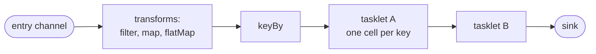
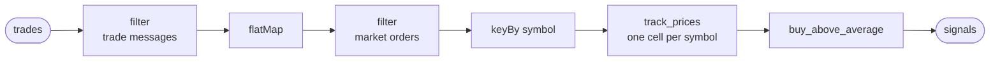

# Streams

A stream is an operator that runs in flow, the default run: you start it once,
and it handles each message the moment it arrives, for as long as it runs. It
suits an endless input, such as trades from an exchange, events from a queue
or rows from a change feed. An ETL stream (extract, transform, load) is the
typical case: take data from one place, change it into what you need, and
deliver it somewhere else.

A stream's graph is a path: messages enter on a channel, pass through
transforms and tasklets, and leave on sinks. Each result goes out as soon as it
is ready. Messages with the same key are handled one at a time, in the order
they arrived, while different keys are handled side by side, and each key can
keep state of its own.

## How it works



- **An entry channel** is where messages come in: from a plugin such as a
  WebSocket or Kafka source, from `flz operator send`, or from another
  operator. Its name is an address that outside things use.
- **Transforms** are small steps written into the path, with no class of their
  own: `filter` drops messages, `map` reshapes one into another, `flatMap`
  splits one into several.
- **`keyBy`** decides which cell of the next tasklet each message goes to.
- **`into`** hands each message to a tasklet. What a tasklet emits flows on
  like any other message, so the next tasklet is added with another `into`.
- **A sink** is a named exit where results leave the operator for whatever
  listens there: a plugin, `flz operator listen`, another operator.

A stream's commit point is one input. Each input's state changes and outputs
are recorded as it is handled, so after a crash the stream carries on from the
last input it finished. How much can repeat or be lost depends on the class's
`durable` and `exactly` settings ([`durability.md`](durability.md)).

## Transforms

`map`, `filter`, `flat_map` (`flatMap`) and `key_by` (`keyBy`) are edge
methods: they sit on the channel between two nodes, not in a tasklet. A
stateless reshaping step costs one line instead of a tasklet, and the key is
visible where the graph is wired rather than inside the consumer.

Everything declared between one `into` and the next is fused into one step on
that edge, so a value crosses a mailbox once, at the next tasklet, however
many transforms it passed. There is nothing to configure about this.

**A transform runs where messages are routed**, once per value, on the thread
that routes them. Two rules follow:

- **Pure and total.** A transform runs again when inputs are replayed after a
  crash. One that reads the clock or a counter rebuilds a state the live run
  never had.
- **Cheap.** An expensive transform holds up routing for every consumer of
  that channel. Real work belongs in a tasklet behind `keyBy`, which spreads it
  over cells.

A transform should only look at the message and hand something on. Anything
more, such as keeping prices, is a tasklet.

**A transform that throws** does not stop routing. In a stream, the value
takes the channel's retry ladder (`retry_max`, `retry_backoff_ms`) and, when
the attempts run out, goes to the dead-letter queue; the other consumers are
still served and later inputs keep flowing. In Java the transform runs inside
an activation, so a throw is that activation's failure. In a workflow there is
no dead-letter queue: a transform that throws fails the step that produced the
value, with no retry, and the workflow undoes what it did
([`workflows.md`](workflows.md)).

## Keys and cells

A tasklet does its work in cells, each with its own state
([`state.md`](state.md)). How many cells a tasklet gets is decided on the
edge that feeds it:

- **With `keyBy`,** every key gets a cell of its own, made the first time a
  message with that key arrives, without anything being declared for it.
- **Without it,** the tasklet has a single cell that handles every message.

Keying is declared per edge and not inherited: a plain `into` after a keyed
tasklet leaves the next tasklet with one cell. That is right for a tasklet that
keeps nothing per key; one that does needs its own `keyBy`, or one cell would
hold every key at once.

The key function sees the value after the transforms before it, and it is
total: it names a cell for every value and cannot decline one. Drop values
with a `filter` before the key, which is also why `keyBy` comes last, right
before `into`.

Each cell handles its messages one at a time, in the order they arrived. So
per key, a message always sees the state the earlier messages of that key
left. Different cells work side by side.

## Example: watching trades

In the tradedesk example, `trade_watcher` takes trades from an exchange. A
trade message says `"channel": "trade"` and carries one or more trades in its
`data` list; the same connection also carries other messages, such as the
confirmation of a subscription. The operator keeps the trade messages, splits
each into its trades, keeps the market orders, and keys them by symbol into
`track_prices`, which keeps each symbol's last ten prices. `buy_above_average`
then decides whether to buy, and its lines leave on the sink `signals`.



<!-- tabs-open -->

### Java

```java
// TradeWatcherOperator.java: the stream. Trades in, signals out.
@JsonIgnoreProperties(ignoreUnknown = true)
public record TradeMessage(String channel, List<Trade> data) {}
...
@Override
public void channels(@Nonnull ChannelBuilder c) {
    c.input(TradeMessage.class, "trades")
            .filter(message -> "trade".equals(message.channel())) // trade messages only
            .flatMap(Trade.class, TradeMessage::data)            // a message into its trades
            .filter(trade -> "market".equals(trade.ord_type()))  // market orders only
            .keyBy(Trade::symbol)                                // one cell per symbol
            .into(TrackPrices.class)
            .into(BuyAboveAverage.class)
            .sink("signals");
}
```

Full file: [`TradeWatcherOperator.java`](https://github.com/flezha/flezha_java_sdk/blob/main/examples/tradedesk/src/main/java/com/flezha/examples/tradedesk/TradeWatcherOperator.java).

`map` and `flatMap` take the type they produce as an explicit `Class`, here
`Trade.class`, because erasure cannot recover it from a lambda; `filter` and
`keyBy` need none. The default JSON decoding refuses a field the record does
not name, so `@JsonIgnoreProperties` tells it to drop the exchange's other
fields.

### Rust

```rust
// src/trade_watcher.rs: the stream. Trades in, signals out.
#[derive(Clone, Deserialize)]
pub struct TradeMessage {
    #[serde(default)]
    channel: String,
    #[serde(default)]
    data: Vec<Trade>,
}
...
fn channels(c: &ChannelBuilder) {
    c.input::<TradeMessage>("trades")
        .filter(|message| message.channel == "trade") // trade messages only
        .flat_map(|message| message.data) // a message into its trades
        .filter(|trade| trade.ord_type == "market") // market orders only
        .key_by(|trade| trade.symbol.clone()) // one cell per symbol
        .into::<TrackPrices>()
        .into::<BuyAboveAverage>()
        .sink_named("signals");
}
```

Full file: [`src/trade_watcher.rs`](https://github.com/flezha/flezha_rust_sdk/blob/main/examples/tradedesk/src/trade_watcher.rs).

The subscription confirmation has neither field, and `#[serde(default)]` lets
it decode as an empty message so the first `filter` can drop it; without it,
the confirmation would fail to decode and be set aside. `into::<P>()` checks at
compile time that `P` takes what the edge carries.

### Node

```javascript
// trade_watcher_operator.mjs: the stream. Trades in, signals out.
channels: (c) => {
  c.input('trades')
    .filter((message) => message.channel === 'trade') // trade messages only
    .flatMap((message) => message.data) // a message into its trades
    .filter((trade) => trade.ord_type === 'market') // market orders only
    .keyBy((trade) => trade.symbol) // one cell per symbol
    .into(TrackPrices)
    .into(BuyAboveAverage)
    .sink('signals');
},
```

Full file: [`trade_watcher_operator.mjs`](https://github.com/flezha/flezha_node_sdk/blob/main/examples/tradedesk/trade_watcher_operator.mjs).

The entry names no codec, so each message arrives as the object its JSON
decodes to, and each transform is a function over that object. The
confirmation has no `channel`, so the first `filter` reads `undefined` there
and drops it.

### Python

```python
# trade_watcher.py: the stream. Trades in, signals out.
(
    c.input("trades")
    .filter(lambda message: message.get("channel") == "trade")  # trade messages only
    .flat_map(lambda message: message["data"])  # a message into its trades
    .filter(lambda trade: trade["ord_type"] == "market")  # market orders only
    .key_by(lambda trade: trade["symbol"])  # one cell per symbol
    .into(TrackPrices)
    .into(BuyAboveAverage)
    .sink("signals")
)
```

Full file: [`trade_watcher.py`](https://github.com/flezha/flezha_python_sdk/blob/main/examples/tradedesk/trade_watcher.py).

The entry names no codec, so each message arrives as the dict its JSON decodes
to. The confirmation has no `channel`, so the first `filter` reads it with
`.get` and drops it.

### Ruby

```ruby
# trade_watcher_operator.rb: the stream. Trades in, signals out.
channels do |c|
  c.input("trades")
   .filter { |message| message[:channel] == "trade" }      # trade messages only
   .flat_map { |message| message[:data] }                  # a message into its trades
   .filter { |trade| trade[:ord_type] == "market" }        # market orders only
   .key_by { |trade| trade[:symbol] }                      # one cell per symbol
   .into(TrackPrices)
   .into(BuyAboveAverage)
   .sink("signals")
end
```

Full file: [`trade_watcher_operator.rb`](https://github.com/flezha/flezha_ruby_sdk/blob/main/examples/tradedesk/trade_watcher_operator.rb).

Each message arrives as the Hash its JSON decodes to, with Symbol keys. The
confirmation has no `:channel`, so the first `filter` reads `nil` there and
drops it.

### PHP

```php
// src/TradeWatcherOperator.php: the stream. Trades in, signals out.
public static function channels(Builder $c): void
{
    $c->input('trades')
        ->filter(fn (array $message) => ($message['channel'] ?? null) === 'trade') // trade messages only
        ->flatMap(fn (array $message) => $message['data'])                         // a message into its trades
        ->filter(fn (array $trade) => $trade['ord_type'] === 'market')             // market orders only
        ->keyBy(fn (array $trade) => $trade['symbol'])                             // one cell per symbol
        ->into(TrackPrices::class)
        ->into(BuyAboveAverage::class)
        ->sink('signals');
}
```

Full file: [`src/TradeWatcherOperator.php`](https://github.com/flezha/flezha_php_sdk/blob/main/examples/tradedesk/src/TradeWatcherOperator.php).

Each message arrives as the array its JSON decodes to. The confirmation has no
`channel`, so the first `filter` reads it with `?? null` and drops it.

### Elixir

```elixir
# lib/tradedesk/trade_watcher.ex: the stream. Trades in, signals out.
@impl true
def channels(c) do
  c
  |> input_with("trades", &Jason.decode/1)
  |> filter(&(&1["channel"] == "trade"))
  |> flat_map(& &1["data"])
  |> filter(&(&1["ord_type"] == "market"))
  |> key_by(& &1["symbol"])
  |> into(Tradedesk.TrackPrices)
  |> into(Tradedesk.BuyAboveAverage)
  |> sink("signals")
end
```

Full file: [`lib/tradedesk/trade_watcher.ex`](https://github.com/flezha/flezha_elixir_sdk/blob/main/examples/tradedesk/lib/tradedesk/trade_watcher.ex).

The entry channel hands on the bytes each message arrives as, so
`input_with/3` names a parser, `Jason.decode/1`, and each transform is a
function over the map it decodes to. `use Flezha.SDK.Operator` imports the
builder, so the pipe needs no module prefix.

<!-- tabs-close -->

Three messages on their way through this path:

```json
{"method": "subscribe", "req_id": 1, "result": {"channel": "trade", "symbol": "EUR/USD"}, "success": true}
{"channel": "trade", "type": "update", "data": [
  {"symbol": "EUR/USD", "side": "buy", "price": 1.0850, "qty": 1000, "ord_type": "market", "trade_id": 1, "timestamp": "2026-09-22T10:00:00.000000Z"},
  {"symbol": "EUR/USD", "side": "sell", "price": 1.0851, "qty": 500, "ord_type": "limit", "trade_id": 2, "timestamp": "2026-09-22T10:00:00.000000Z"},
  {"symbol": "EUR/USD", "side": "sell", "price": 1.0853, "qty": 2000, "ord_type": "market", "trade_id": 3, "timestamp": "2026-09-22T10:00:00.000000Z"}
]}
{"channel": "trade", "type": "update", "data": [
  {"symbol": "USD/JPY", "side": "buy", "price": 149.50, "qty": 1000, "ord_type": "market", "trade_id": 4, "timestamp": "2026-09-22T10:00:01.000000Z"}
]}
```

The first `filter` drops the subscription confirmation. `flatMap` turns the two
trade messages into four trades, each going on alone. The second `filter`
drops the limit order. `keyBy` changes no message; it sends each to its
symbol's cell:

```text
EUR/USD's cell:  {"symbol": "EUR/USD", "price": 1.0850, "ord_type": "market"}
                 {"symbol": "EUR/USD", "price": 1.0853, "ord_type": "market"}
USD/JPY's cell:  {"symbol": "USD/JPY", "price": 149.50, "ord_type": "market"}
```

EUR/USD's 1.0850 is handled before its 1.0853, because one cell handles its
messages in order. `track_prices` keeps its window in the cell
([`state.md`](state.md#example-a-window-of-prices)), and `buy_above_average`,
fed by a plain `into`, has one cell for every symbol, which is fine for a
tasklet that keeps nothing.

## Sinks

`sink(name)` ends a path on a named exit. A sink can also sit in the middle of
a path: a value leaves there and still carries on to the next tasklet, and a
path can have several sinks. A second sink on one channel is refused at
registration. The sink's name is stamped on everything it delivers, so like an
entry channel's name it is an address: changing it is a breaking change.

A sink names the channel it ends: in Rust, `sink_named("signals")` names it and
`sink()` leaves it the tasklet's name. Naming the same channel again with
`named(...)` is refused (`topology.channel_named_twice`). Where results go
from a sink (a file, Kafka, an HTTP endpoint, a listener) is the plugin
attached to it ([`plugins.md`](plugins.md)).

## Edge options

The channel that feeds a tasklet carries its delivery settings, for a stream
and a workflow alike:

| Option | Default | What it does |
| --- | --- | --- |
| `on_full(policy)` (`onFull`) | `DropNothing` | What a full cell mailbox does: `DropNothing` slows the producer to the consumer's rate, `DropNewest` and `DropOldest` discard. Nothing is dropped by default. |
| `retry_max(n)` (`retryMax`) | 3 | Attempts before a failing input is parked in the dead-letter queue. `0` is refused (`topology.retry_max_zero`). |
| `retry_backoff_ms(ms)` (`retryBackoffMs`) | 50 | Base of the exponential wait between attempts; the wait holds no thread. |
| `keyed()` | off | Every plugin output must carry a natural key. Requires a sink; required on every plugin channel under `effectively_once`. |
| `key_by(f)` (`keyBy`) | none: one cell | Route by a key function. |

A cell's mailbox holds 1024 messages unless the tasklet sets
`mailbox_capacity` or the environment sets `FLEZHA_MAILBOX_CAPACITY`. The
[configuration reference](../../configuration/operator_settings.md#channel-and-edge-options) has
the full table.

## Starting work from a stream

A tasklet in a stream can start another operator. In the tradedesk example,
`buy_above_average` starts one `order_executor` workflow for each buy, and
hands it the order as its first message:

<!-- tabs-open -->

### Java

```java
// BuyAboveAverage.java: buys when a price is far enough above its average.
ctx.spawnSteps("order_executor", new OrderTicket(move.symbol(), quantity));   // one steps operator per order
```

Full file: [`BuyAboveAverage.java`](https://github.com/flezha/flezha_java_sdk/blob/main/examples/tradedesk/src/main/java/com/flezha/examples/tradedesk/BuyAboveAverage.java).

### Rust

```rust
// src/buy_above_average.rs: buys when a price is far enough above its average.
let order = serde_json::to_vec(&ticket).map_err(|e| TaskletError::Custom(e.to_string()))?;
let _ = ctx.spawn_steps("order_executor", order); // one steps operator per order
```

Full file: [`src/buy_above_average.rs`](https://github.com/flezha/flezha_rust_sdk/blob/main/examples/tradedesk/src/buy_above_average.rs).

### Node

```javascript
// buy_above_average.mjs: buys when a price is far enough above its average.
const order = { symbol: move.symbol, quantity };
ctx.spawnSteps('order_executor', order); // one steps operator per order
```

Full file: [`buy_above_average.mjs`](https://github.com/flezha/flezha_node_sdk/blob/main/examples/tradedesk/buy_above_average.mjs).

### Python

```python
# buy_above_average.py: buys when a price is far enough above its average.
order = OrderTicket(symbol=move["symbol"], quantity=quantity)
ctx.spawn_steps("order_executor", order)  # one steps operator per order
```

Full file: [`buy_above_average.py`](https://github.com/flezha/flezha_python_sdk/blob/main/examples/tradedesk/buy_above_average.py).

### Ruby

```ruby
# buy_above_average.rb: buys when a price is far enough above its average.
order = { symbol: move[:symbol], quantity: quantity }
ctx.spawn_steps("order_executor", order)               # one steps operator per order
```

Full file: [`buy_above_average.rb`](https://github.com/flezha/flezha_ruby_sdk/blob/main/examples/tradedesk/buy_above_average.rb).

### PHP

```php
// src/BuyAboveAverage.php: buys when a price is far enough above its average.
$order = ['symbol' => $input['symbol'], 'quantity' => $quantity];
$ctx->spawnSteps('order_executor', $order);        // one steps operator per order
```

Full file: [`src/BuyAboveAverage.php`](https://github.com/flezha/flezha_php_sdk/blob/main/examples/tradedesk/src/BuyAboveAverage.php).

### Elixir

```elixir
# lib/tradedesk/buy_above_average.ex: buys when a price is far enough above its average.
# One steps operator per order.
spawn_steps(ctx, "order_executor", %{symbol: symbol, quantity: quantity})
```

Full file: [`lib/tradedesk/buy_above_average.ex`](https://github.com/flezha/flezha_elixir_sdk/blob/main/examples/tradedesk/lib/tradedesk/buy_above_average.ex).

<!-- tabs-close -->

The spawn sends the order as JSON and returns a handle that reports whether
the order started; the example does not wait on it, since waiting would hold
the price stream up. A spawn names a factory whose class runs in steps; naming
one that runs in flow answers `factory_not_steps`. The rules, and the risks of
a spawn without an id, are in
[`../advanced/spawning_from_a_tasklet.md`](../advanced/spawning_from_a_tasklet.md).

## Refusals

The graph is checked when the runner registers the operator, the same way in
every SDK:

| Code | When |
| --- | --- |
| `topology.duplicate_key_by` | two `keyBy` on one edge, or on one merge |
| `topology.transform_after_terminal` | a transform or key declared on a handle a plugin sink already closed |
| `topology.transform_after_key_by` | a transform declared after the key it would feed |
| `topology.dangling_transform_chain` | a transform chain that no `into` closes |
| `topology.key_by_on_unkeyable_target` | a `keyBy` edge into a tasklet that declares fixed cell keys |
| `topology.unkeyed_edge_into_dynamic_tasklet` | an edge without a key into a tasklet that another edge keys |
| `topology.edge_already_wired` | a consumer edge declared again where either side carries a transform or a key |

`topology.transform_after_terminal` makes the order of declarations matter
where a channel carries both a sink and a transformed consumer: close the
transform on its `into(...)` first, then attach the sink to the handle you
kept. Declaring the same plain `into` twice, with no transform or key, is
allowed and wires one edge, not two.

## Limits and gotchas

- **Keying is per edge.** A tasklet after a keyed one has one cell unless its
  own edge is keyed too.
- **Transforms must stay cheap and side-effect free**; this is not checked.
- **A blocking call in a tasklet holds a worker** of the runner. How much that
  costs depends on the SDK ([`building_blocks.md`](building_blocks.md#concurrency-per-language)).
- **A dropping overflow policy loses messages by design**, and is refused on
  an effectively-once class.
- **A stream does not end by itself.** It runs until it is stopped, a tasklet
  calls `complete`, or its `max_duration_ms` passes. On `complete` it first
  runs the work its cells already hold to their outputs.
- **In a workflow, the entry channel's transforms** run as in a stream: a
  message reaches the first step mapped, filtered or split as declared.

## See also

- [`configuring_an_operator.md`](configuring_an_operator.md): the settings tree, and `run: flow`.
- [`state.md`](state.md): cells and their state.
- [`workflows.md`](workflows.md): the other run.
- [`durability.md`](durability.md): what a stream keeps through a crash.
- [`plugins.md`](plugins.md): what feeds an entry channel and what a sink delivers to.
- [`../advanced/partitioning.md`](../advanced/partitioning.md), [`../advanced/merged_inputs.md`](../advanced/merged_inputs.md),
  [`../advanced/timers.md`](../advanced/timers.md), [`../advanced/effectively_once.md`](../advanced/effectively_once.md).
- [`../../sdk/stream_transforms.md`](https://github.com/flezha/flezha/blob/main/docs/sdk/stream_transforms.md): where the transform code lives, for contributors.
- Tutorial: [`watch_the_trades.md`](../../tutorials/tradedesk/watch_the_trades.md) builds `trade_watcher`.
