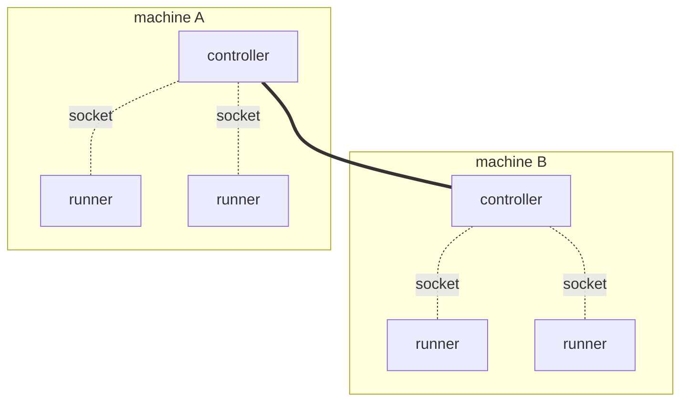

# Connecting a runner

A runner is a program of your own that runs your operators. It connects to a
controller, tells it which operator factories it can run, and then does the
work the controller gives it. This page covers how a runner reaches its
controller, how to run it as a service, and how to check that it connected.

You start and stop runners yourself, like any other service. Flezha does not
start, stop or restart a runner: `flz` has no command for it, and the
controller works only with the runners that connect to it.

## How a runner reaches the controller

A runner and its controller talk over a Unix domain socket, so they are on the
same machine. That is the intended shape rather than a limitation: **each
machine that runs runners runs a controller too**, and the runners on it
attach to that local controller through a directory the two share. The
controllers find each other and behave as one system, so a runner only talks
to the one on its own machine. The shipped Kubernetes manifests have exactly
this shape: a DaemonSet with one controller per node.



Dotted lines are Unix domain sockets, which stay on one machine. The solid
line is the controllers clustering ([`clustering.md`](clustering.md)).

**QUIC is the other transport, and it is [experimental: quic](../../publishing/maturity.md#quic).**
It lets a runner cross a machine boundary: `FLEZHA_TRANSPORT=quic` plus
`FLEZHA_QUIC_ADDRESSES`, a comma separated list of names or addresses, port
4433 by default. It needs certificates on both ends
([`authorization.md`](../basics/authorization.md)) and is far less exercised than the
socket. Prefer the socket.

Each entry of `FLEZHA_QUIC_ADDRESSES` is a name or a literal address with an
optional port. Each entry is resolved through DNS on every connection attempt,
so a controller that moves behind its name is followed with no
reconfiguration, and an entry that fails to resolve is one failed candidate
rather than a fatal error. A runner that has connected once dials that
address first on later attempts, and orders the other candidates randomly, so
a fleet-wide restart does not converge on one node. Reconnecting to the same
controller only moves the binding; reconnecting to another leaves the previous
controller's operators stranded until its own convergence loop heals them.
`FLEZHA_QUIC_ADDRESS` is retired and not aliased: set alone, it refuses the
start, naming the replacement. The controller's own listen address is
`FLEZHA_QUIC_LISTEN_ADDRESS`.

### The socket directory

Both sides look for the socket directory the same way and stop at the first
candidate:

1. `FLEZHA_SOCKET_FILES_PATH`, when it is set: it names the directory outright.
2. `$XDG_RUNTIME_DIR/flezha`
3. `/run/flezha`
4. `./app_data/sockets`, relative to the working directory.

The controller prints the answer on every boot:

```output
[flezha] runners attach with FLEZHA_SOCKET_FILES_PATH=/run/user/1000/flezha
```

`flz runner check` walks the same list a runner walks, needs neither a runner
nor a controller to run, and exits zero only when a controller answered:

```sh
$ flz runner check
```

```output
controller reachable
  directory  /run/user/1000/flezha (from $XDG_RUNTIME_DIR/flezha)
  checked    /run/user/1000/flezha
             /run/flezha
             /srv/flezha/app_data/sockets
```

When it does not connect, `flz runner check` names the verdict and the fix.
Every verdict, and the two failures that are not verdicts:
[`../../troubleshooting/runner_cannot_connect.md`](../../troubleshooting/runner_cannot_connect.md).

### Where the controller runs

<!-- tabs-open -->

### Binaries

**Nothing to configure.** On one machine, as one user, the runner resolves the
same directory the controller did. Start it and it connects.

**A different user is the one case that needs work.** Directory traversal is
the authentication boundary here, and the socket directory is `0700`, so
another user cannot reach it. Either run the runner as the controller's user,
or start the controller with `FLEZHA_SOCKET_DIR_GROUP=<group>`, a group both
users belong to, which makes the directory `0750` owned by that group. The
controller logs a warning naming the group on every boot, and a group the
controller's user does not belong to refuses the boot. No setting opens the
directory wider than that. With two users, point both sides at an explicit
`FLEZHA_SOCKET_FILES_PATH`: `$XDG_RUNTIME_DIR` differs per user, so the
zero-configuration path works for one user only.

### Docker

**The socket is inside the container,** so the question is how to share that
one directory. Give it a volume of its own, separate from the data volume, and
mount it in both places.

If the runner is also a container, a named volume is the whole answer:

```sh
$ docker run -d --name flezha-controller \
  -v flezha_data:/flezha/app_data \
  -v flezha_sockets:/flezha/app_data/sockets \
  flezha/flezha:0.1.0

$ docker run -d --name my-runner \
  -e FLEZHA_SOCKET_FILES_PATH=/flezha/app_data/sockets \
  -v flezha_sockets:/flezha/app_data/sockets \
  my-runner-image
```

```sh
$ docker exec my-runner flz runner check
```

```output
controller reachable
  directory  /flezha/app_data/sockets (from $FLEZHA_SOCKET_FILES_PATH)
  checked    /flezha/app_data/sockets
```

If the runner runs on the host instead, bind mount a host directory in place
of the named volume:

```sh
$ docker run -d --name flezha-controller \
  -v flezha_data:/flezha/app_data \
  -v /tmp/flz_sock:/flezha/app_data/sockets \
  flezha/flezha:0.1.0

$ FLEZHA_SOCKET_FILES_PATH=/tmp/flz_sock flz runner check
```

**That one has a condition.** The image runs as uid 1000 and the directory it
creates is `0700`, so the host user has to be uid 1000 as well, or the socket
is there and unreachable. Two containers do not have this problem, because
both run as the same uid.

Keep the path short either way: the directory is capped at 60 bytes, because a
runner's data socket address has to fit beside it.

### Kubernetes

One controller per node, as a DaemonSet, with the runners on each node
attached to it: [`kubernetes.md`](kubernetes.md).

### Elixir application

**A runner in the same node as the controller uses no socket at all.** The
Elixir SDK's in-node mode is a function call:

```elixir
children = [{Flezha.SDK, namespace: "default", operators: [MyOperator], transport: :native}]
```

`:native` is the default, and it is deliberately not taken from the
environment: a controller sets `FLEZHA_TRANSPORT` for its own server, and a
runner that followed it would dial its own node over a socket. A connect from
another BEAM node is refused.

A runner that is its own node is an ordinary standalone runner, written with
`transport: :uds`, and the **Binaries** tab applies to it unchanged.

<!-- tabs-close -->

## Run it as a service

A runner is an ordinary program: run it from a terminal, under systemd, in
Docker or Kubernetes, or under any supervisor you already use. Once it runs,
it connects and offers the controller the factories it registered, and from
then on the controller decides what runs on it.

Three things matter when a supervisor runs it:

- **Stop it with SIGTERM.** The runner shuts down cleanly. Ctrl-C in a
  terminal does the same.
- **Restart it whenever it exits.** Losing the controller is not a reason to
  exit: the runner reconnects on its own, waiting longer between attempts, up
  to 30 seconds. It exits when it crashes, and when the controller tells a
  stuck runner to leave, with exit code 70, so that its supervisor starts a
  fresh one.
- **Keep standard input open for Node, Python, Ruby and PHP.** These runners
  stop when standard input closes, unless it is a terminal, so a supervisor
  that starts them without one stops them at once. `docker run -i` keeps it
  open, and so does `stdin_open: true` in a compose file.

Each runner takes the namespace it serves when it starts
([`namespaces.md`](../basics/namespaces.md)). In the example runners it is the first
argument, `default` when omitted. One way to start each language's echo
runner, from its example folder:

<!-- tabs-open -->

### Java

```sh
$ mvn -q package && java -jar target/echo.jar
```

The jar carries the SDK, so nothing else goes on the classpath. The first
argument is the namespace.

### Rust

```sh
$ cargo run --release
```

The namespace follows `--`: `cargo run --release -- my_app`.

### Node

```sh
$ npm install && node runner.mjs
```

Start it from the example's folder, because the operator's module specifier
resolves against the working directory. The first argument is the namespace.

### Python

With Python 3.11 or later:

```sh
$ pip install -r requirements.txt && python3 runner.py
```

The first argument is the namespace.
[`sdk/python/examples/echo_deployment`](https://github.com/flezha/flezha_python_sdk/tree/main/examples/echo_deployment)
starts a controller and this runner together with Docker.

### Ruby

With Ruby 3.3 or later:

```sh
$ bundle install && bundle exec ruby runner.rb
```

The first argument is the namespace.

### PHP

With PHP 8.4 or later and `ext-ffi`:

```sh
$ composer install && php runner.php
```

The first argument is the namespace.

### Elixir

```sh
$ mix deps.get && mix run --no-halt
```

The namespace follows `--`: `mix run --no-halt -- my_app`. A standalone
Elixir runner is your own application, so it starts the way your application
starts. An in-node runner has nothing to start: `Flezha.SDK` is a child in
your application's supervision tree, in the same node as the controller.

<!-- tabs-close -->

## Check that it connected

```sh
$ flz runner list
```

```output
Fetching runners for namespace 'default'...
Runners in namespace 'default':
  - default_23fc85126379
```

The runner's id in that list means it connected. When it is missing,
[`../../troubleshooting/runner_cannot_connect.md`](../../troubleshooting/runner_cannot_connect.md)
names each reason with its fix.

## One runner, one namespace

A runner process serves exactly one namespace, and at most one runner may run
in a process: a second one started beside it is refused, naming the namespace
already running. Serving two namespaces means two processes.

Two runner processes in the same namespace, on one machine, are an ordinary
way to spread the work, but each needs an identity file of its own. The
controller binds operators to a runner's durable identity, which the runner
reads from `FLEZHA_RUNNER_ID_PATH`, `/var/lib/flezha-runner/id` by default.
Two processes reading one file present one identity, and the newer one takes
the older one's work. Give each process its own path, or run them in
containers, where the default path is separate already.

The identity is also what lets a restarted runner pick its operators back up:
it presents the same identity, and the controller binds the operators it held
onto it again.

## Limits and gotchas

- **Socket transport is one machine.** A runner on another machine needs a
  controller of its own there, or the experimental QUIC transport.
- **Short paths.** The socket directory is capped at 60 bytes.
- **Different users need a shared group** (`FLEZHA_SOCKET_DIR_GROUP`); the
  directory is not opened wider than `0750`.
- **A runner that connects runs nothing yet.** Operators are started
  separately ([`running_operators.md`](../basics/running_operators.md)).

## See also

- [`building_blocks.md`](../basics/building_blocks.md): what a runner is, and the code that registers its factories.
- [`deploying_a_controller.md`](deploying_a_controller.md): the controller the runner attaches to.
- [`namespaces.md`](../basics/namespaces.md): the namespace a runner serves.
- [`kubernetes.md`](kubernetes.md), [`clustering.md`](clustering.md).
- [Files and sockets](../../configuration/files_and_sockets.md#the-socket-directory-ladder): the socket-directory settings.
- [`../../troubleshooting/runner_cannot_connect.md`](../../troubleshooting/runner_cannot_connect.md).
- Tutorial: [`write_the_echo_runner.md`](../../tutorials/echo/write_the_echo_runner.md) starts the echo runner.
