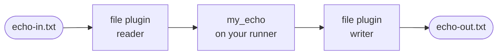

# The echo

These pages build the smallest complete Flezha deployment by hand: a
controller, a runner of your own that serves an `echo` relay, and a file on
each side of it. A line added to one file comes back as its echo at the end of
the other.



The pages share one running controller, started on the first page and stopped
on the last.

Each step has a purple box with a pencil, right above the command to run. The
steps are not optional: to reach the working example at the end, do every one
of them, in order. The box says what to do and names anything that has to be in
place first.

A command with no purple box above it is there to read or to check, and the
page does not need it. The copy button on a command copies the command
alone, without the `$` prompt. What it prints is shown right below it, and your
ids, tokens and times will differ.

> #### What you need {: .tip}
>
> - **For the controller**, a Linux machine on x86-64 to run the release, or
>   Docker to run its image.
> - **For your runner**, one language, and only what its row lists:
>
> | Language | You need |
> |---|---|
> | Java | Java 21 and Maven |
> | Rust | Rust with Cargo |
> | Node | Node.js 20 or later, with npm |
> | Python | Python 3.11 or later, with pip |
> | Ruby | Ruby 3.3 or later, with Bundler |
> | PHP | PHP 8.4 or later with `ext-ffi`, and Composer |
> | Elixir | Elixir 1.17 or later |
>
> - **git**, to get the example.

> Get the example: clone the repository. The echo of each language is in
> `sdk/<language>/examples/echo`.
> {: .step}

```sh
$ git clone --recurse-submodules https://github.com/flezha/flezha.git
```

| Page | What you end up with |
|---|---|
| [Start the controller](start_the_controller.md) | A controller running, and a check that it is up |
| [Write the echo runner](write_the_echo_runner.md) | Your own runner connected to it, registering the `echo` factory |
| [Run the echo](run_the_echo.md) | A relay started on that runner, taking messages and answering them |
| [Feed the echo a file](feed_the_echo_a_file.md) | A file as its input and another as its output |
| [Stop everything](stop_everything.md) | Everything above stopped |
